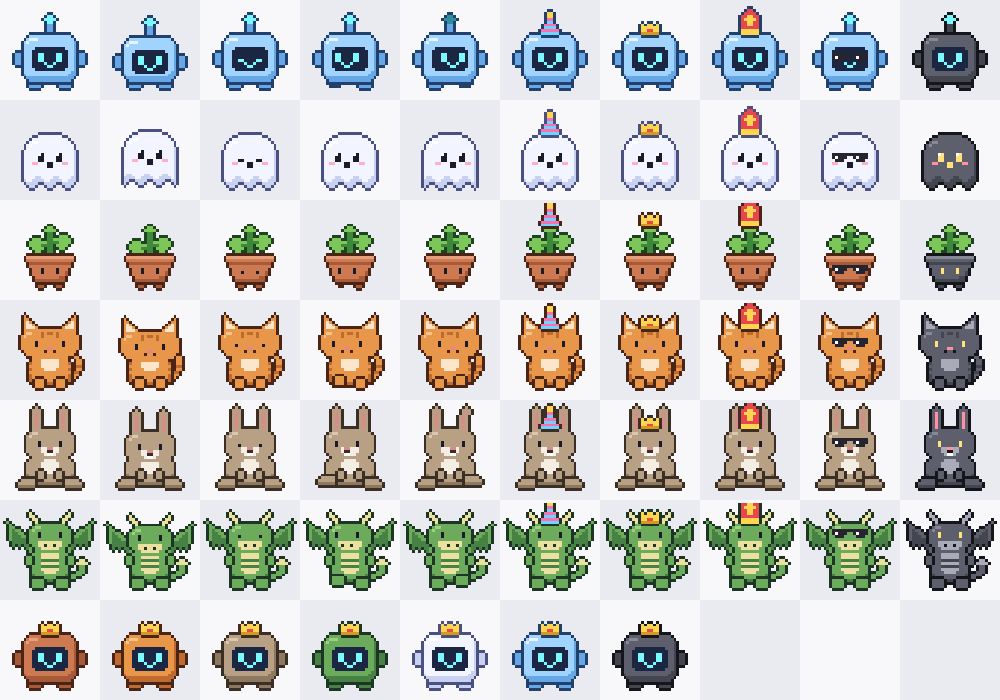

# Pixling

Een klein pixelmaatje dat op je bureaublad woont. Het wandelt over de onderkant van je scherm, kijkt naar je muis, valt in slaap als je even weg bent en laat zich oppakken en weggooien. Je past het aan via het icoontje in de menubalk.

## Wat het nu kan (v0.1)

- Zes maatjes: Robotje, Spookje, Boontje, Kat, Konijn en Draakje
- Zeven kleuren, vier accessoires (feesthoedje, kroontje, mijter, zonnebril) en drie groottes
- Wandelt rond, ademt, knippert en kijkt naar je cursor
- Valt na een minuut zonder muisbeweging in slaap en wordt wakker zodra je de muis beweegt
- Laat zich oppakken en slepen; laat je los terwijl je beweegt, dan gooi je hem, met zwaartekracht en stuiteren
- Een klik is een aai: hij springt op en er verschijnt een hartje
- Klikken gaan dwars door het venster heen, behalve op het maatje zelf
- Leeft in de menubalk, zonder Dock-icoon; je instellingen blijven bewaard

Het standaardmaatje is het Robotje in hemelblauw met een kroontje.

## Starten

Nodig: Node.js 22 of nieuwer, Rust (via rustup) en de Xcode Command Line Tools.

| Commando | Wat het doet |
| --- | --- |
| `npm install` | Pakketten installeren (één keer) |
| `npm run tauri dev` | Pixling starten in ontwikkelmodus |
| `npm run tauri build` | Een `.app` en `.dmg` bouwen |
| `npm run check` | Typecheck en tests; moet slagen voor elke commit |
| `npm run sprites` | Alle maatjes tekenen naar `docs/sprites.png`, om tekenwerk na te kijken |
| `npm run icons` | App-icoon en menubalkicoon opnieuw maken |
| `npm run dev` | Alleen de webpagina in je browser, handig voor tekenwerk |

## Hoe het in elkaar zit

| Map | Inhoud |
| --- | --- |
| `src/sprites/` | De maatjes, in code getekend: één bestand per soort, plus kleuren, accessoires en emotes |
| `src/buddy/brain.ts` | Het gedrag: rondlopen, slapen, slepen, gooien en aaien, los van het scherm zodat het testbaar is |
| `src/buddy/view.ts` | Tekent het maatje en zijn tekstballon op het canvas |
| `src/main.ts` | Verbindt alles: cursor opvragen, klikken doorlaten, de tekenlus |
| `src-tauri/` | De Rust-kant: het doorzichtige venster, de menubalk en de instellingen |
| `scripts/` | Bouwhulpjes: sprite-overzicht en iconen, getekend met dezelfde engine |
| `docs/` | Visie, roadmap en beslissingen |

Meer uitleg: [visie](docs/VISIE.md), [roadmap](docs/ROADMAP.md), [beslissingen](docs/BESLISSINGEN.md).

## Platformen

Eerst macOS, daarna Windows, als laatste Linux. Tauri draait op alle drie, maar doorzichtige vensters en klikken doorlaten gedragen zich per systeem anders, dus Windows en Linux moeten nog getest en bijgestuurd worden.
