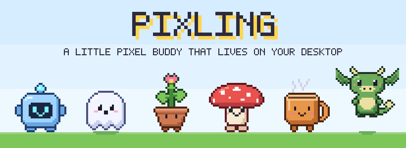
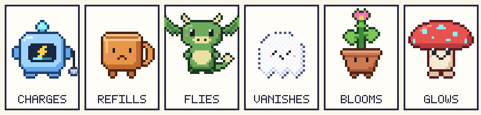
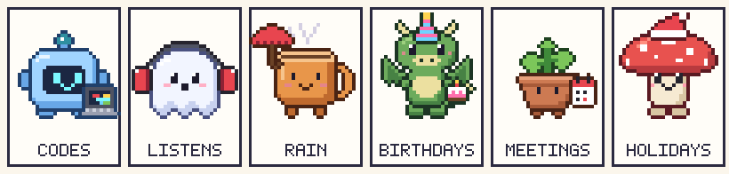
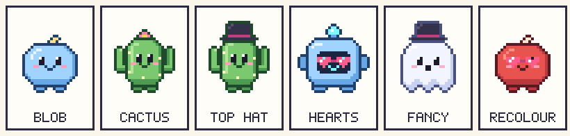

<p align="center">
  
</p>

<p align="center">
  It walks along your screen, climbs your windows, watches along with what you're doing<br>
  and helps you through your day, through its behaviour instead of notifications.
</p>

<p align="center">
  <a href="https://github.com/VR0EM/Pixling/releases/latest"></a>
  <a href="https://github.com/VR0EM/Pixling/actions/workflows/ci.yml"></a>
  
  
  <a href="LICENSE"></a>
</p>

<p align="center">
  <a href="https://github.com/VR0EM/Pixling/releases/latest/download/Pixling-mac.dmg"><strong>Download for macOS</strong></a>
  &nbsp;·&nbsp;
  <a href="https://github.com/VR0EM/Pixling/releases/latest/download/Pixling-windows-setup.exe"><strong>Download for Windows</strong></a>
  &nbsp;·&nbsp;
  <a href="https://github.com/VR0EM/Pixling/releases">All releases</a>
</p>

---

## Contents

- [Features](#features)
- [Make your own buddy](#make-your-own-buddy)
- [Privacy](#privacy)
- [Install](#install)
- [Build from source](#build-from-source)
- [How it works](#how-it-works)
- [Roadmap](#roadmap)
- [Contributing](#contributing)
- [License](#license)

## Features

### It's alive

Your buddy walks along the bottom of the screen, breathes, blinks and follows your cursor with its eyes. It climbs onto the top edge of your windows and rides along when you drag them, and falls off when you close one. Pick it up and throw it across the screen, pet it with a click, and when you step away it falls asleep. Clicks pass straight through everything but the buddy, and it never takes the focus from the app you're working in.

### Six buddies, each with a personality



| Buddy | What only it does |
| --- | --- |
| **Robot** | Its battery drains while you work. It slows down, plugs itself in and races around once it's full. |
| **Mug** | The coffee cools down and runs out. Click it for a refill; it's fresh every morning. |
| **Dragon** | Flies across the screen and onto your windows, and glides down when you throw it. |
| **Ghost** | Hovers, fades away and pops up somewhere else. |
| **Sprout** | Gets thirsty and droops. Water it and it grows a little every day, until it blooms. |
| **Shroom** | Bounces like a sponge, sneezes spores and glows at night. |

Every buddy talks in its own voice, mixed with one of four characters you pick: *sweet*, *hyper*, *calm* or *cheeky*. Eight colours, a handful of accessories and three sizes do the rest.

### It watches along



- **Your apps:** a laptop next to it while you code, headphones for music (drawn for every buddy), popcorn for video, a controller for games. It only knows *which* app is in front, never what's in it.
- **Your calendar** (Google Calendar, iCloud, Outlook): what's on in the morning, a heads-up ten minutes before a meeting, quiet during meetings, fading into the background during video calls, and "How did it go?" afterwards.
- **The weather** in your town: an umbrella and rain, a beanie and snow, sunglasses in the sun.
- **The time and the year:** coffee in the morning, a nightcap at night, a pumpkin at Halloween, a Santa hat and snow on your windows in winter, an Easter egg hunt, cake on your birthday.

### It helps, without nagging

- **Focus timer:** it sits reading next to you while the time runs next to the menu bar icon, then takes a break with you.
- **Reminders through behaviour:** it holds up a glass of water now and then, and gets tired before it tells you to take a break.
- **Quick notes:** type, press Enter, done.
- **Feed it files:** drop a file on it to zip it, convert an image to PNG or JPG, copy the path or show it in Finder or Explorer.
- **Your computer:** it goes limp when the battery runs low and sweats when the processor works hard.

### Play together

From the menu, under **Play**:

- **Fetch:** throw the ball with your mouse; it runs after it and brings it back to your cursor.
- **Hide and seek:** it hides behind the edge of a window or off the side of the screen. Click it when you find it.
- **Basket:** a hoop appears on your screen; throw your buddy through it. Drag the hoop wherever you like, and close it with its ×.

Games only start when you pick one. Now and then your buddy asks if you want to play.

### Make it yours

- **Wardrobe:** buddy, colour, accessory, size, character and habits, with a living preview.
- **Studio:** draw your own hats, glasses and things to hold, or a whole buddy of your own.
- **Diary and sticker book:** one sentence about every day together, and stickers for little achievements, some of which unlock new accessories.
- **Every feature has a switch.** Quirks, games, weather, holidays, stickers, the calendar and the reminders can each be turned off in the wardrobe or the menu.

## Make your own buddy



Everything you make is a small, readable `.pixling.json` file. Draw it in the studio, share it with **Share** or **Copy**, and add someone else's by dropping the file on your buddy. Or let an AI assistant make one:

1. In the studio, click **Copy AI prompt**.
2. Paste it into ChatGPT, Claude or Gemini and describe what you'd like, for example *"a tiny cactus with a pink flower on its head"*.
3. Paste the answer into **Add a file…**. Your new buddy breathes, walks and blinks right away.

The format, the style guide and examples are in **[Creating buddies](docs/CREATING-BUDDIES.md)**.

## Privacy

Pixling is built to stay on your computer.

- No accounts, no analytics, no telemetry.
- It never takes screenshots and never reads what you type. It only knows which app is in front and where windows are.
- Your settings, notes, diary and creations live in your app data folder.
- It only goes online when you turn something on: your calendar is read from the secret address you paste in, and the weather is fetched from [Open-Meteo](https://open-meteo.com) with just your town's coordinates.

## Install

**macOS 11 or newer** (Apple Silicon and Intel): download [Pixling-mac.dmg](https://github.com/VR0EM/Pixling/releases/latest/download/Pixling-mac.dmg), open it and drag Pixling to Applications.

**Windows 10 and 11:** download the [installer](https://github.com/VR0EM/Pixling/releases/latest/download/Pixling-windows-setup.exe), or the [portable version](https://github.com/VR0EM/Pixling/releases/latest/download/Pixling-windows-portable.exe) that runs without installing.

Pixling lives in the menu bar (macOS) or the system tray (Windows). Double-click your buddy to open the wardrobe, and right-click it for the menu.

**Updates come by themselves** (from 0.10 on): Pixling looks for a new version now and then, your buddy tells you when there is one, and **Update** in the menu installs it. Nothing is installed until you pick it, and you can switch the looking off in the wardrobe.

<details>
<summary><strong>"Apple could not verify…" or "Windows protected your PC"</strong></summary>

Pixling isn't signed with a paid Apple or Microsoft certificate yet, so the first start needs one extra step:

- **macOS:** open Pixling once. When macOS refuses, go to **System Settings → Privacy & Security** and click **Open Anyway**.
- **Windows:** when SmartScreen appears, click **More info → Run anyway**.

</details>

## Build from source

You need [Node.js](https://nodejs.org) 22 or newer, [Rust](https://rustup.rs), and on macOS the Xcode Command Line Tools.

```bash
git clone https://github.com/VR0EM/Pixling.git
cd Pixling
npm install
npm run tauri dev
```

| Command | What it does |
| --- | --- |
| `npm run tauri dev` | Run Pixling in development mode |
| `npm run tauri build` | Build the app and an installer for your platform |
| `npm run install-mac` | Build the release and copy it to Applications (macOS) |
| `npm run check` | Typecheck and tests; must pass before every commit |
| `npm run sprites` | Draw every buddy in every pose to `docs/sprites.png` |
| `npm run readme-art` | Draw the pictures in this README |
| `npm run icons` | Make the app and menu bar icons again |
| `npm run dev` | Only the web pages, in your browser |

**Releases** are built by GitHub: raise the version in `package.json`, `src-tauri/Cargo.toml` and `src-tauri/tauri.conf.json`, then push a tag like `v0.10.0`. The [release workflow](.github/workflows/release.yml) builds the .dmg and both Windows .exe files, signs the updates with the key in the `TAURI_SIGNING_PRIVATE_KEY` repository secret, and publishes everything with a `latest.json` that installed copies read to find the update.

## How it works

Pixling is a [Tauri 2](https://tauri.app) app: a small Rust side for the operating system, and a TypeScript web page without a framework for everything you see.

- The buddy lives in **one transparent window over the whole screen** that lets clicks through, except where the buddy is.
- The buddies are **drawn in code** on a 32×32 grid, in layers that get their outline automatically, with colours from a palette. So every buddy comes in every colour, every hat fits every head, and the pictures in this README are drawn by the same engine.
- **Behaviour is pure TypeScript**, apart from the screen, so it's covered by tests: walking, physics, games, the calendar, the weather, the backpack.
- **The Rust side** reads the window list and the app in front (CoreGraphics and AppKit on macOS, Win32 on Windows), runs the menu and stores the settings as JSON.

<details>
<summary><strong>Project structure</strong></summary>

| Path | Contents |
| --- | --- |
| `src/sprites/` | The buddies, accessories, items, palettes and emotes, and the renderer |
| `src/sprites/buddy.ts`, `src/sprites/format.ts` | Home-made buddies, and reading and writing Pixling files |
| `src/buddy/brain.ts` | Behaviour: walking, sleeping, dragging, throwing, climbing, flying, hiding |
| `src/buddy/traits.ts`, `src/buddy/species-voice.ts` | What makes each built-in buddy itself |
| `src/buddy/voice.ts` | What it says, per character and situation |
| `src/buddy/games.ts`, `src/buddy/world.ts` | Fetch, hide and seek and basket; the ball, hoop, eggs, snow and rain |
| `src/buddy/calendar.ts`, `src/buddy/agenda.ts` | Reading calendars, and what the buddy does with them |
| `src/buddy/weather.ts`, `src/buddy/seasons.ts`, `src/buddy/stickers.ts` | Weather, holidays and birthdays, the sticker book |
| `src/buddy/backpack.ts`, `src/buddy/diary.ts` | Focus timer and reminders; the diary |
| `src/main.ts` | Ties it all together |
| `src/wardrobe.ts`, `src/studio.ts`, `src/notes.ts`, `src/diary-page.ts` | The windows |
| `src-tauri/src/` | The Rust side; `macos.rs` and `win.rs` per platform |
| `scripts/` | Sprite sheet, icons and README art, drawn with the same engine |
| `examples/` | Example Pixling files |

</details>

More background: [vision](docs/VISION.md) · [decisions](docs/DECISIONS.md) · [creating buddies](docs/CREATING-BUDDIES.md) · [all sprites](docs/sprites.png)

## Roadmap

macOS comes first, then Windows, then Linux. Next up:

- Two buddies at once, waving to each other and playing tag
- Music playing in the background, not only when the music app is in front
- Hiding during fullscreen apps and screen sharing
- Writing your own phrases and "if … then …" rules

The full list is in the [roadmap](docs/ROADMAP.md).

## Contributing

Ideas, bug reports and buddies are welcome: open an [issue](https://github.com/VR0EM/Pixling/issues), or share a `.pixling.json` file.

For code: `npm run check` must pass, art follows the [style guide](docs/CREATING-BUDDIES.md#style-guide) (front view, stylised, its own silhouette), and anything you draw is checked with `npm run sprites`. The [decisions](docs/DECISIONS.md) explain why things are built the way they are.

## License

Pixling is released under the [MIT License](LICENSE): use it, change it and share it, as long as the copyright notice stays with it. Buddies and accessories you make and share are yours.

The speech bubbles use [Pixelify Sans](https://fonts.google.com/specimen/Pixelify+Sans), under the SIL Open Font License 1.1.
